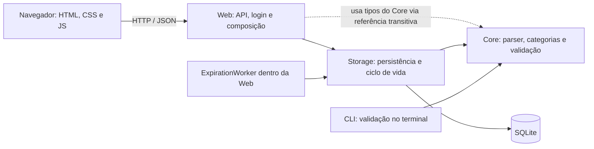
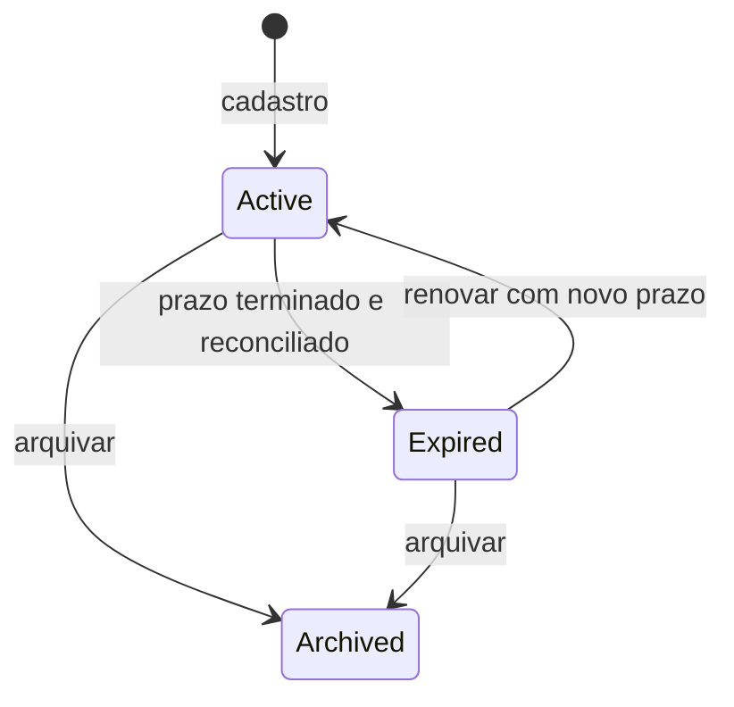

# LinkKeeper por dentro

**Guia de produto, arquitetura e leitura do código.** Edição de 25/10/2026.
Base funcional conferida: commit `af8e761`, branch `codex/resume-validation`.
Esta documentação é um incremento separado na branch `codex/project-documentation`,
baseada nessa implementação; ela não altera o funcionamento da aplicação.

O LinkKeeper recebe um link acompanhado de categoria e prazo, guarda essa referência
e permite encontrá-la depois. Quando o prazo termina, o link sai da lista de ativos,
mas continua no histórico. A versão atual funciona localmente no navegador, com uma
senha de acesso pessoal e banco SQLite persistente.

Se quiser explorar antes de ler, abra o [mapa visual interativo](mapa-do-projeto.html)
no navegador. Ele explica componentes e percorre um exemplo fixo de cadastro.
Para acompanhar este guia no VS Code, abra o arquivo e pressione **Ctrl+Shift+V**.
Os diagramas Mermaid também têm sua explicação no texto, caso seu visualizador
não os desenhe.

## Como usar este guia

| Seu objetivo | Comece por |
| --- | --- |
| Entender o produto e experimentar | [O que funciona](#produto) e [roteiro de teste](#experimentar) |
| Entender as pastas e dependências | [Mapa do repositório](#pastas) e [arquitetura](#arquitetura) |
| Acompanhar o código executando | [A viagem de um link](#fluxo) e [roteiro no VS Code](#leitura) |
| Entender regras e banco | [Categorias e prazos](#regras), [estados](#estados) e [persistência](#banco) |
| Entender API e proteção de acesso | [Contrato HTTP](#api) e [segurança](#seguranca) |
| Saber o que foi entregue e o que falta | [Histórico](#historico), [testes](#testes) e [evolução](#evolucao) |

Você pode seguir o texto em ordem. Os conceitos de C# e infraestrutura usados aqui
estão explicados no [glossário](#glossario).

<a id="produto"></a>
## 1. O que já funciona

Imagine que você encontrou uma vaga e quer mantê-la visível por uma semana:

```text
https://empresa.example/vaga --vaga-emprego /7dias
```

O sistema entende a URL, converte `vaga-emprego` para a categoria `jobs`, calcula
a validade e grava o registro. Você pode pesquisar pela URL ou descrição,
filtrar a coleção, arquivar o link ou renovar um link expirado.

| Capacidade | Situação atual |
| --- | --- |
| Interface no navegador | Implementada em HTML, CSS e JavaScript |
| Login e logout | Implementados para uma conta pessoal |
| Cadastro e persistência | Implementados na API, usando SQLite |
| Busca, categoria e estado | Implementados; lista de até 200 itens por consulta |
| Arquivamento | Implementado, preservando o registro |
| Expiração | Implementada por worker e reconciliação nas consultas |
| Renovação | Implementada; botão da interface renova por sete dias |
| CLI | Valida comandos e retorna JSON; ainda não grava no banco |
| HTTPS público para celular | Pendente; o endereço local não é um deploy público |
| WhatsApp oficial | Pendente |
| Contas distintas para várias pessoas | Pendente |
| CI remoto aprovado | Sem execuções registradas na consulta desta edição |

O produto atual é uma versão pessoal em desenvolvimento. A estrutura prepara
alguns pontos para evolução, mas a experiência disponível ainda corresponde
a uma única conta: quem conhece a senha acessa a mesma coleção.

<a id="arquitetura"></a>
## 2. Arquitetura: quem faz o quê

A aplicação web é um **monólito modular**: um processo ASP.NET Core atende a
interface, executa a API e mantém o worker de expiração. O código é dividido em
quatro projetos de produção e um projeto de testes. A CLI é outro executável, que reutiliza
o Core e pode ser iniciado separadamente.



As setas representam uso/dependência. O caminho de execução de um cadastro aparece
na próxima seção; ele tem idas e voltas entre a API e esses componentes.

| Parte | Responsabilidade | O que conhece |
| --- | --- | --- |
| **Core** | Interpretar comandos, resolver categorias, validar dados e representar links | Tipos da biblioteca padrão do .NET |
| **Storage** | Executar SQL, persistir, consultar e mudar estados | Core e Microsoft.Data.Sqlite |
| **Web** | Receber HTTP, autenticar, aplicar CSRF, compor serviços e servir a interface | Storage e, transitivamente, Core |
| **CLI** | Receber argumentos do terminal e apresentar validação | Core |
| **Frontend** | Coletar texto, chamar a API e mostrar os resultados | Contrato HTTP da Web |

O Core não importa ASP.NET nem SQLite. Assim, a interpretação de um comando pode
ser usada por mais de um canal. Isso já acontece entre CLI e Web. O WhatsApp
futuro deverá reutilizar as regras, mas esse adaptador ainda não existe.

Há espaço para uma separação futura entre domínio e casos de uso. Hoje não existem
projetos `Domain` e `Application` separados nem uma camada completa de serviços
de aplicação: o Core concentra regras, e os endpoints chamam `LinkStore`
diretamente. Essa é a estrutura efetiva do código.

<a id="fluxo"></a>
## 3. A viagem de um link, do botão ao banco

Use este exemplo durante a leitura:

```text
https://empresa.example/vaga --vaga-emprego /7dias
```

```mermaid
sequenceDiagram
    participant Pessoa
    participant JS as app.js
    participant API as Web/Program.cs
    participant Parser as CommandParser
    participant Store as LinkStore
    participant DB as SQLite
    Pessoa->>JS: Preenche comando e clica Guardar
    JS->>API: POST /api/links/ com cookie, CSRF e JSON
    Note over API: Autenticação, limite e CSRF
    API->>Parser: Parse(command)
    Parser-->>API: ParsedLink com categoria jobs e datas UTC
    API->>Store: Add(owner, parsed, description)
    Note over Store: Validação compartilhada e normalização
    Store->>DB: INSERT e SELECT na mesma transação
    DB-->>Store: Registro novo ou existente
    Store-->>API: Item e indicador Created
    API-->>JS: 201 se novo; 200 se duplicado
    JS->>API: GET /api/links/ para atualizar a coleção
    API-->>JS: Lista de links
    JS-->>Pessoa: Exibe cartões e mensagem
```

1. **O formulário captura o texto.** Em [app.js](../src/LinkKeeper.Web/wwwroot/app.js),
   o handler de `createForm.onsubmit` impede o envio tradicional do formulário
   e chama `request()` com JSON. O botão fica desabilitado durante a operação.
2. **A API verifica o acesso.** Em [Program.cs da Web](../src/LinkKeeper.Web/Program.cs),
   o grupo `/api/links` exige autenticação. Operações de escrita passam pelo filtro
   de CSRF. O proprietário vem da identidade autenticada, não do JSON recebido.
3. **O parser interpreta o comando.** [CommandParser.cs](../src/LinkKeeper.Core/CommandParser.cs)
   exige a sintaxe esperada, valida a URL, consulta o catálogo de categorias e
   calcula a expiração a partir do relógio recebido.
4. **A API pede a gravação.** Ela entrega `ParsedLink` e descrição ao
   [LinkStore.cs](../src/LinkKeeper.Storage/LinkStore.cs). O armazenamento repete
   as invariantes necessárias porque também pode ser chamado sem o parser.
5. **O banco decide se a referência já existe.** A chave única combina proprietário,
   URL normalizada e categoria. A operação usa transação e não sobrescreve o prazo
   de um duplicado. Depois lê o registro correspondente e devolve o resultado.
6. **A interface mostra o estado do servidor.** Após a gravação, chama `load()`
   para consultar a lista novamente. Os cartões são montados com os dados da API.

O formato enviado é:

```json
{
  "command": "https://empresa.example/vaga --vaga-emprego /7dias",
  "description": "Conferir os requisitos da vaga"
}
```

Uma resposta de criação contém `{ "item": { ... }, "created": true }`.
O objeto `item` contém os campos descritos na seção de dados. A interface usa
`created` para distinguir cadastro novo de referência já existente.

Se a criação ocorrer em `2026-10-25T12:00:00Z`, sete dias significam expiração
em `2026-11-01T12:00:00Z`: **168 horas depois**. Esse exemplo é ilustrativo;
o horário real vem de `TimeProvider`.

<a id="pastas"></a>
## 4. Mapa completo do repositório

Esta árvore agrupa o código versionado e os principais arquivos locais. `bin`,
`obj`, SDK, banco e resultados de teste são gerados ou locais e ficam fora do Git.

```text
LinkKeeper/
├── src/
│   ├── LinkKeeper.Core/
│   │   ├── LinkKeeper.Core.csproj
│   │   ├── CategoryCatalog.cs
│   │   ├── CommandParser.cs
│   │   ├── LinkItem.cs
│   │   └── LinkValidation.cs
│   ├── LinkKeeper.Storage/
│   │   ├── LinkKeeper.Storage.csproj
│   │   ├── LinkStore.cs
│   │   └── Migrations/001-links.sql
│   ├── LinkKeeper.Web/
│   │   ├── LinkKeeper.Web.csproj
│   │   ├── Program.cs
│   │   └── wwwroot/
│   │       ├── index.html
│   │       ├── style.css
│   │       └── app.js
│   └── LinkKeeper.Cli/
│       ├── LinkKeeper.Cli.csproj
│       └── Program.cs
├── tests/LinkKeeper.Tests/
│   ├── LinkKeeper.Tests.csproj
│   ├── CommandParserTests.cs
│   ├── CategoryCatalogTests.cs
│   ├── LinkStoreTests.cs
│   └── StorageValidationTests.cs
├── scripts/smoke-web.py
├── docs/
│   ├── README.md
│   ├── GUIA-DO-PROJETO.md
│   ├── mapa-do-projeto.html
│   ├── FOUNDATION.md
│   ├── VALIDATION.md
│   ├── WEB-STATUS.md
│   └── RESUMPTION.md
├── .vscode/
│   ├── settings.json
│   └── tasks.json
├── .github/workflows/ci.yml
├── Directory.Build.props
├── global.json
├── Dockerfile
├── .dockerignore
├── .gitignore
├── AGENTS.md
├── README.md
├── .tools/               # local: SDK, checkpoints e diagnóstico
└── linkkeeper.db         # local: dados; pode ter arquivos -wal e -shm
```

### Core: comece pelas regras

| Arquivo | Como lê-lo |
| --- | --- |
| [CategoryCatalog.cs](../src/LinkKeeper.Core/CategoryCatalog.cs) | Veja os defaults, a aplicação de configuração e a construção final dos aliases. `Resolve()` transforma nome ou alias em uma política. |
| [CommandParser.cs](../src/LinkKeeper.Core/CommandParser.cs) | Siga `Parse()` de cima para baixo: tamanho, partes, URL, categoria, duração e datas. `ParsedLink` é a saída intermediária. |
| [LinkValidation.cs](../src/LinkKeeper.Core/LinkValidation.cs) | `RequireHttpUrl()` protege a URL; `Canonicalize()` valida dados construídos diretamente e padroniza categoria e datas. |
| [LinkItem.cs](../src/LinkKeeper.Core/LinkItem.cs) | Leia os três estados e os campos do registro persistido. |

### Storage: veja onde a mudança se torna persistente

| Trecho de [LinkStore.cs](../src/LinkKeeper.Storage/LinkStore.cs) | Papel |
| --- | --- |
| Construtor | Configura a conexão, ativa WAL e aplica o script inicial dentro de uma transação. |
| `Open()` | Abre uma conexão SQLite para uma operação. |
| `Normalize()` | Gera a forma de comparação usando a URL validada e `Uri.AbsoluteUri`. |
| `Add()` | Valida dados, tenta inserir e retorna o registro novo ou existente. |
| `List()` | Valida o estado, reconcilia expiração, aplica filtros e retorna até 200 registros. |
| `Get()` | Busca um ID dentro do proprietário, após reconciliar expiração. |
| `Archive()` | Muda para `Archived` e registra as datas correspondentes. |
| `Renew()` | Reativa um expirado e calcula a nova validade a partir de agora. |
| `Expire()` | Atualiza em lote os ativos cujo prazo terminou. |
| `Read()` | Converte uma linha SQL para `LinkItem`. |

### Web: o ponto de montagem da aplicação

O [Program.cs](../src/LinkKeeper.Web/Program.cs) concentra cinco blocos:

1. Leitura de configuração e registro dos serviços.
2. Configuração de autenticação, autorização, CSRF e limites.
3. Pipeline HTTP: cabeçalhos, tratamento de alguns erros, arquivos estáticos e acesso.
4. Endpoints de login, links, logout e saúde.
5. DTOs de entrada e a classe `ExpirationWorker`, declarados no final do arquivo.

Os arquivos de [wwwroot](../src/LinkKeeper.Web/wwwroot/index.html) dividem a tela:

- `index.html`: estrutura, formulários, opções e regiões de mensagem.
- `style.css`: cores, tipografia, espaçamento, cartões e adaptação de largura.
- `app.js`: requisições, sessão, montagem dos cartões, filtros e ações.

### CLI: outra entrada para o mesmo parser

O [Program.cs da CLI](../src/LinkKeeper.Cli/Program.cs) junta os argumentos, executa
o parser e imprime JSON com `mode: "validation-only"`. Usa o catálogo padrão.
Um comando inválido escreve a mensagem em stderr e encerra com código `2`;
sucesso e `--help` encerram com código `0`.

### Arquivos de apoio

| Arquivo | Por que existe |
| --- | --- |
| [Directory.Build.props](../Directory.Build.props) | Compartilha `net10.0`, nullable, usings implícitos e avisos tratados como erros. |
| [global.json](../global.json) | Solicita SDK `10.0.402`, permitindo patch compatível da mesma faixa por `latestPatch`. |
| Arquivos `.csproj` | Definem o tipo de projeto e suas referências. |
| [.vscode/tasks.json](../.vscode/tasks.json) | Oferece os comandos de build, teste, smoke e início local. |
| [.vscode/settings.json](../.vscode/settings.json) | Direciona novos terminais Windows ao SDK local e reduz a observação de `.tools`. |
| [.github/workflows/ci.yml](../.github/workflows/ci.yml) | Declara build e testes no GitHub para push/PR; não é evidência de que já executaram. |
| [Dockerfile](../Dockerfile) | Descreve publicação em uma imagem SDK e execução em imagem ASP.NET, como usuário `app`, na porta 8080. |
| [.dockerignore](../.dockerignore) | Lista itens que não entram no contexto da imagem; deve ser revisto antes de um build real. |
| [.gitignore](../.gitignore) | Exclui SDK, bancos, arquivos de ambiente, build e resultados locais do versionamento. |
| [AGENTS.md](../AGENTS.md) | Registra restrições de engenharia para agentes que modificarem este projeto. |

<a id="regras"></a>
## 5. Sintaxe, categorias e prazo

```text
[URL] --[categoria] /[validade opcional conforme a política]
```

O parser aceita um comando com duas ou três partes, separadas por whitespace.
Exige uma única URL e categoria. A validade explícita fica na terceira parte.
`/7d` e `/7dias` são tokens válidos; `/7 dias`, separado em duas partes, não é.
Há limite de 4096 caracteres para o comando.

| Entrada | Resultado |
| --- | --- |
| `https://example.com --jobs` | Categoria `jobs`, prazo de 30 dias |
| `https://example.com --VAGA-EMPREGO /7dias` | Categoria `jobs`, sete dias |
| `https://example.com --fun` | Permanente |
| `https://example.com --art` | Permanente |
| `https://example.com --fun /14d` | Prazo explícito de 14 dias |
| `https://example.com --jobs /permanente` | Permanente, apesar do default de jobs |
| `https://example.com --video /30d` | Aceito, com 30 dias |
| `https://example.com --video` | Rejeitado: sem prazo padrão configurado |
| `https://example.com --estudo /permanente` | Aceito, permanente |
| `https://example.com --ler-depois /7d` | Aceito, sete dias |

Nomes e aliases são resolvidos sem diferenciar caixa. A categoria persistida usa
o nome canônico. Esquemas como `javascript:` e `ftp:` são recusados, assim como
URLs com credenciais embutidas. A aplicação guarda o endereço: não baixa a página,
não gera resumo e não extrai metadados do destino.

### Configuração de categorias

A Web lê a seção `Categories` pela configuração do ASP.NET. O exemplo abaixo é
uma configuração ilustrativa, não um arquivo já adicionado ao projeto:

```json
{
  "Categories": [
    { "Name": "jobs", "DefaultDays": 7 },
    { "Name": "pesquisa", "DefaultDays": 14, "Aliases": ["research"] }
  ]
}
```

Nesse exemplo, `vaga-emprego` continua resolvendo para `jobs`, agora com sete dias.
`research` passa a resolver para `pesquisa`. O parser e o armazenamento da Web
recebem o mesmo catálogo.

Regras de substituição:

- Omitir `Aliases` herda os aliases da política anterior.
- Informar uma lista de `Aliases` substitui a lista anterior.
- Informar `Aliases: []` remove os aliases herdados.
- Um alias não pode tomar o nome ou alias de outra categoria.
- Política permanente não pode simultaneamente definir `DefaultDays`.

O filtro visual de categorias ainda oferece somente `jobs`, `fun` e `art`.
Os demais registros aparecem em **Todas**, mas falta gerar esse seletor a partir
do catálogo configurado.

### URL original, URL normalizada e duplicação

`OriginalUrl` guarda o texto original. `NormalizedUrl` usa a representação
`AbsoluteUri` do .NET para comparação. Não há remoção arbitrária de parâmetros.
Query e fragmento participam da comparação, conforme o comportamento atual e o
teste de preservação desses elementos.

O teste usa, por exemplo, `https://EXAMPLE.com:443/path?q=Value#section` e espera
`https://example.com/path?q=Value#section`, mantendo a URL original separadamente.

Uma duplicata é a mesma combinação de **proprietário + URL normalizada + categoria**.
O sistema retorna o registro existente, inclusive se estiver arquivado ou expirado,
e não muda silenciosamente seu prazo, descrição ou estado. Para um expirado existe
a ação explícita de renovação. Desarquivamento ainda não foi implementado.

<a id="estados"></a>
## 6. Vida de um registro



| Estado | Significado no uso normal | Ação disponível na interface |
| --- | --- | --- |
| `Active` | Registro da coleção ativa; permanente ou ainda dentro do prazo | Arquivar |
| `Expired` | Prazo encerrado e estado atualizado | Renovar por sete dias ou arquivar |
| `Archived` | Arquivamento explícito | Consultar pelo filtro de arquivados |

Expirar e arquivar preservam os dados. Não existe exclusão definitiva na interface
nem endpoint de exclusão nesta versão. Também não existe ação de desarquivar.

**Renovação:** o novo vencimento é `agora + dias`, não `vencimento antigo + dias`.
A API permite de 1 a 36500 dias. O armazenamento também aceita renovar um registro
ainda marcado `Active` cujo prazo já passou, mesmo antes de o worker marcá-lo
como `Expired`. Um arquivado e um ativo ainda válido não podem ser renovados.

### Quem percebe que o tempo terminou?

O `ExpirationWorker` está no final de `Web/Program.cs`. Ele chama `Expire()` no
início e repete a execução com um `PeriodicTimer`. O intervalo padrão é 60 segundos;
`ExpirationSeconds` é limitado pelo código ao intervalo de 5 a 3600 segundos.

`Expire()` executa uma atualização condicional:

```sql
UPDATE links
SET status = 'Expired', updated_at = $now
WHERE status = 'Active' AND expires_at <= $now;
```

A fronteira é inclusiva: vencimento igual a agora já está expirado. Uma nova
execução não transiciona de novo uma linha já expirada. Há teste real com oito
chamadas concorrentes e uma única transição total.

`List()` e `Get()` também chamam `Expire()`. Assim, a consulta reconcilia prazos
caso o worker ainda não tenha atualizado os registros. Hoje essa chamada é global,
para todos os proprietários, embora a consulta de dados seja limitada ao usuário.

O worker só executa enquanto o processo está ativo. A interface precisa atualizar
a lista para refletir a mudança; não há atualização por push. Falhas SQLite no
loop são registradas sem conteúdo dos links e uma nova tentativa ocorre no ciclo
seguinte. Testes próprios do loop e de indisponibilidade continuam pendentes.

<a id="banco"></a>
## 7. Dados e persistência

O banco local desta sessão fica em `C:\Users\samue\Projetos\LinkKeeper\linkkeeper.db`.
O caminho vem de `LINKKEEPER_DB`. Se essa configuração não for informada, o código
usa `linkkeeper.db` relativo ao diretório de trabalho do processo.

| Campo de `LinkItem` | Coluna | Papel |
| --- | --- | --- |
| `Id` | `id` | Identificador gerado como GUID sem hífens |
| `OwnerId` | `owner` | Dono da referência; na Web atual é `personal` |
| `OriginalUrl` | `original_url` | Endereço enviado |
| `NormalizedUrl` | `normalized_url` | Endereço usado para comparação |
| `Category` | `category` | Nome canônico da categoria |
| `Description` | `description` | Texto opcional; armazenado vazio quando ausente na API |
| `Source` | `source` | Origem; hoje a gravação fixa o valor `API` |
| `CreatedAt` | `created_at` | Momento de criação |
| `UpdatedAt` | `updated_at` | Momento da última mudança de estado executada pelo armazenamento |
| `ExpiresAt` | `expires_at` | Vencimento; `NULL` representa permanência |
| `Status` | `status` | `Active`, `Expired` ou `Archived` |
| `ArchivedAt` | `archived_at` | Momento do arquivamento, quando houver |

Datas são persistidas como milissegundos Unix e lidas como `DateTimeOffset` UTC.
Na tela, `toLocaleString("pt-BR")` usa o fuso do navegador. Ainda não existe
preferência de fuso persistida na conta.

### O que o SQL garante

O script [001-links.sql](../src/LinkKeeper.Storage/Migrations/001-links.sql):

- Cria `links` e a tabela `schema_versions`.
- Define a chave única de deduplicação e restringe os estados por `CHECK`.
- Cria índices para expiração e consulta por proprietário/estado/criação.
- Registra a versão inicial do schema.

O script é um recurso embutido na biblioteca Storage e aplicado na inicialização
do repositório. Ele é idempotente, mas ainda não existe um executor completo
de múltiplas versões de migração. Acrescentar uma nova coluna exige planejar
esse avanço; editar somente um `CREATE TABLE IF NOT EXISTS` não altera bancos antigos.

O código usa **SQL parametrizado** e `Microsoft.Data.Sqlite`, sem Entity Framework.
`Add()` usa uma transação para inserir e recuperar o registro correspondente.
O modo WAL é habilitado; por isso podem existir os arquivos `-wal` e `-shm`
ao lado do banco. Eles também estão fora do Git. Copiar apenas o `.db` enquanto
há gravações não constitui um procedimento de backup validado.

`LinkItem` e `ParsedLink` são records construíveis. Não são entidades que, sozinhas,
impedem qualquer estado inválido. A proteção implementada está nos caminhos de
entrada: parser, validação compartilhada e `LinkStore.Add`. O código de validação
do armazenamento verifica URL, categoria, criação obrigatória e expiração posterior
à criação antes de gravar, além do limite de 1000 caracteres da descrição.

<a id="api"></a>
## 8. Contrato HTTP que a interface utiliza

Os exemplos usam `http://127.0.0.1:5017`. Operações de links exigem cookie de sessão;
escritas exigem também o cabeçalho `X-CSRF-TOKEN`. A aplicação não oferece Swagger
ou documentação OpenAPI gerada nesta versão.

| Método e rota | Entrada | Resultado normal |
| --- | --- | --- |
| `GET /health` | Sem autenticação | `200`, `{ "status": "ok" }`; liveness, sem consulta dedicada ao banco |
| `GET /api/csrf` | Cookie antiforgery quando já existir | `200`, token de requisição; pode emitir cookie antiforgery |
| `POST /api/login` | JSON com `password` e token CSRF | `200` e cookie de sessão; `401` para senha incorreta |
| `POST /api/logout` | Sessão e CSRF | `204`; encerra a sessão |
| `GET /api/links/` | Opcionais `status`, `category`, `q` | `200`, array de links |
| `POST /api/links/` | JSON com `command` e `description` opcional | `201` se criou; `200` se retornou duplicado |
| `GET /api/links/{id}` | ID | `200` com link; `404` se não está disponível para o proprietário |
| `POST /api/links/{id}/archive` | ID e CSRF | `204` se mudou; `404` se não mudou/encontrou |
| `POST /api/links/{id}/renew` | JSON com `days` e CSRF | `204` se renovou; `409` quando o registro não pode ser renovado |

Exemplo de consulta:

```text
/api/links/?status=Expired&category=jobs&q=backend
```

`status` aceita exatamente `Active`, `Expired` e `Archived`; o default é `Active`.
O filtro `category` compara a categoria armazenada: use o nome canônico.
`q` pesquisa na URL original ou descrição por SQL, não por busca semântica.
A ordenação é por criação decrescente, com ID como desempate; o limite é 200,
sem paginação implementada.

### Erros: leia o comportamento atual

- `400`: erros de entrada tratados, estado inválido e falha de CSRF.
- `401`: sem sessão em rota protegida ou senha incorreta.
- `403`: recusa de acesso pelo mecanismo de autorização, quando aplicável.
- `404`: consulta/arquivamento sem resultado disponível.
- `409`: renovação sem transição permitida.
- `429`: limite de requisições atingido.
- `503`: exceção SQLite tratada pelo middleware.

Argumentos inválidos tratados e falhas SQLite retornam JSON com `error`.
Outros retornos podem ter corpo vazio; os erros ainda não seguem um formato
uniforme em todos os caminhos.

Duas particularidades merecem atenção ao desenvolver clientes: arquivar de novo
um registro já arquivado retorna `404`, e renovar um ID inexistente também retorna
`409` no endpoint atual. Isso descreve a implementação; não significa que todos
os casos HTTP já estejam padronizados.

<a id="seguranca"></a>
## 9. Como o acesso está protegido

O fluxo do navegador é: obter CSRF, enviar login, receber cookie, obter um novo
token CSRF após autenticar e então operar a coleção. `app.js` executa essa sequência.

| Proteção implementada | Finalidade e limite |
| --- | --- |
| Senha por ambiente, mínimo de 16 caracteres | Controla a entrada na conta pessoal; não há cadastro ou tabela de usuários |
| Comparação de hashes em tempo constante | Usada na conferência da senha configurada; não é um sistema de armazenamento de senhas multiusuário |
| Cookie `HttpOnly`, `SameSite=Strict` | Sessão do navegador; duração configurada de oito horas |
| Cookie `Secure` em produção | Exige HTTPS para a sessão de produção; desenvolvimento local usa política própria |
| CSRF | Valida escritas com o cookie e o token de requisição |
| Proprietário pela identidade | O JSON de criação não escolhe livremente um `OwnerId` |
| Limites por janela | Login: 10/minuto; grupo de links: 120/minuto; limites globais por política |
| Corpo HTTP limitado | Kestrel limita o corpo da requisição a 16384 bytes |
| Cabeçalhos e renderização | CSP, `nosniff`, referrer policy; textos dos cartões por `textContent` e links com `noopener noreferrer` |
| SQL parametrizado e validação | Separa valores do SQL e restringe os dados aceitos |

Os limites não são repartidos por IP/conta. O isolamento do repositório entre
proprietários é testado, mas a autenticação da Web mapeia todos os logins válidos
para `personal`. Portanto, essa versão não oferece coleções privadas distintas
para várias pessoas.

Não há prévia remota de páginas: a aplicação não acessa automaticamente URLs
enviadas. Se essa função for adicionada, a política de acesso a endereços externos
precisará ser projetada. As proteções acima não substituem os testes e decisões
de operação pendentes para uma publicação real.

Senhas de teste, cookies, arquivos do banco e URLs pessoais não pertencem a esta
documentação ou ao Git. Este guia não reproduz a senha temporária da sessão.

<a id="testes"></a>
## 10. Como sabemos que os caminhos principais funcionam

A última execução registrada do código funcional desta edição aprovou **57 casos
xUnit**, sem falhas ou ignorados. Os builds Release da CLI e da Web terminaram
sem avisos e sem erros. O smoke HTTP ampliado também passou.

| Arquivo | Casos executados | O que protege |
| --- | ---: | --- |
| [CommandParserTests.cs](../tests/LinkKeeper.Tests/CommandParserTests.cs) | 25 | Sintaxe, defaults, aliases, prazo explícito, UTC, URLs inválidas e tamanho |
| [CategoryCatalogTests.cs](../tests/LinkKeeper.Tests/CategoryCatalogTests.cs) | 7 | Herança/substituição de aliases e colisões de nomes |
| [LinkStoreTests.cs](../tests/LinkKeeper.Tests/LinkStoreTests.cs) | 5 | Reabertura, duplicação, histórico, renovação, isolamento e concorrência |
| [StorageValidationTests.cs](../tests/LinkKeeper.Tests/StorageValidationTests.cs) | 20 | Entradas que contornam o parser, estado textual, normalização e categorias configuradas |

Um método `[Theory]` conta como vários casos quando recebe vários `[InlineData]`.
Por isso o total de testes executados é maior que a quantidade de métodos.

Nos testes de regras e ciclo de vida, o relógio é controlado por `TimeProvider`.
Avançar o tempo é alterar o relógio fornecido ao código, sem esperar sete dias
ou usar sleeps para provar expiração. Os testes de persistência criam bancos
SQLite reais e temporários.

O [smoke-web.py](../scripts/smoke-web.py) inicia outro processo ASP.NET com senha
aleatória, banco temporário e cliente HTTP com cookies. Verifica login, recusa
sem autenticação/CSRF, cadastro, duplicação, busca, URL e estado inválidos,
arquivamento, conflito de renovação, categoria configurada e logout. Não usa
o seu banco de teste pessoal.

### Limites da evidência

Os 57 testes não demonstram cobertura de todo comportamento possível. O loop
hospedado do worker, recuperação de falhas de banco, QA visual em celular,
container e backup/restauração de produção ainda têm verificações pendentes.
Não foi registrado teste em aparelho físico.

O workflow do GitHub contém comandos de build/teste/smoke. Na consulta feita para
este guia, os PRs continuavam em rascunho e não havia execuções de Actions listadas.
Resultados locais e aprovação remota são evidências diferentes.

<a id="experimentar"></a>
## 11. Roteiro para experimentar e reconhecer o resultado

O servidor local desta sessão foi iniciado para uso no navegador. Abra
[LinkKeeper local](http://127.0.0.1:5017) e use a senha local definida na sessão.
O endereço depende do processo no computador; não é um endereço público para celular.

Experimente na ordem abaixo usando dados sintéticos:

| Passo | Ação | O que observar |
| --- | --- | --- |
| 1 | Guardar `https://example.com/guia --jobs /7dias` | Um cartão em `jobs` com vencimento |
| 2 | Reenviar a mesma URL/categoria com `/1d` | Aviso de duplicação e prazo original preservado |
| 3 | Guardar `https://example.com/guia --fun` | Outro registro permitido, agora permanente |
| 4 | Preencher uma descrição e pesquisar parte dela | Lista filtrada pelo texto |
| 5 | Guardar `javascript:alert(1) --fun` | Mensagem de erro; nenhum cartão novo |
| 6 | Guardar `https://example.com/video --video` | Erro por falta de validade explícita |
| 7 | Repetir com `--video /30d` | Registro aceito; visível em Todas |
| 8 | Arquivar o primeiro registro | Some de Ativos e aparece em Arquivados |
| 9 | Reenviar o registro arquivado com a mesma categoria | Retorna o existente; não desarquiva |
| 10 | Sair e tentar atualizar a coleção | Solicitação de login |

A sintaxe só permite prazos em dias ou permanência. Para observar a passagem
de sete dias sem esperar esse tempo, leia/execute `ExpirationPreservesHistoryAndRenewalRestoresActive`
em `LinkStoreTests`. O teste avança um relógio isolado, preservando o banco que
você está usando no navegador.

### Comandos disponíveis no VS Code

Em **Terminal → Executar Tarefa**:

| Tarefa | Efeito |
| --- | --- |
| `LinkKeeper: compilar web` | Build Release da Web e suas dependências; também Ctrl+Shift+B |
| `LinkKeeper: testar` | Executa os testes xUnit e gera resultados TRX |
| `LinkKeeper: smoke HTTP` | Compila a Web e inicia um servidor temporário para o roteiro HTTP |
| `LinkKeeper: iniciar web` | Solicita senha, usa banco local persistente e escuta em `127.0.0.1:5017` |

**A porta 5017 é compartilhada pelo servidor de uso e pelo smoke.** Encerre o
servidor local antes de executar o smoke. Nesta sessão ele foi iniciado em segundo
plano, fora do seletor de tarefas: cancelar uma tarefa do VS Code não encerra esse
processo. O PID está em `.tools/local-web.pid`; confirme que pertence ao LinkKeeper
antes de encerrar um processo. Fechar a aba do navegador não encerra o servidor.

Para ler o parser pelo terminal, usando o SDK isolado deste checkout Windows:

```powershell
.\.tools\dotnet\dotnet.exe run --project src/LinkKeeper.Cli -- 'https://example.com' --jobs /7dias
```

Isso retorna JSON de **validação**, sem criar um link na coleção web.

### Problemas frequentes durante o acompanhamento

| Sintoma | Primeira coisa a conferir |
| --- | --- |
| Navegador não abre `127.0.0.1:5017` | Processo local ativo e porta configurada |
| SDK compatível não encontrado | `global.json`; no Windows deste checkout, `.tools/dotnet/dotnet.exe` |
| Comando `dotnet` usa a versão global antiga | Abra novo terminal do VS Code ou invoque o executável local explicitamente |
| Cookie não funciona em HTTP local | Ambiente de desenvolvimento; produção exige HTTPS |
| Erro de CSRF após mudar a sessão | Recarregue a página para renovar os tokens |
| Referência arquivada não volta ao cadastrar de novo | Deduplicação inclui registros arquivados; desarquivar ainda não existe |
| Categoria aceita no cadastro não aparece no seletor | Filtro visual ainda fixo em jobs/fun/art |
| `/health` responde, mas gravar falha | Health atual não verifica a disponibilidade do banco |

<a id="leitura"></a>
## 12. Um roteiro de leitura que acompanha a execução

Não é necessário decorar os arquivos. O objetivo é conseguir seguir a informação
e dizer qual componente toma cada decisão.

| Ordem | Abra | Procure responder |
| --- | --- | --- |
| 1 | [LinkItem.cs](../src/LinkKeeper.Core/LinkItem.cs) | Que informações definem um link e quais estados ele tem? |
| 2 | [CategoryCatalog.cs](../src/LinkKeeper.Core/CategoryCatalog.cs) | De onde vêm os 30 dias de jobs e como um alias resolve? |
| 3 | [CommandParser.cs](../src/LinkKeeper.Core/CommandParser.cs) | Como o texto vira categoria e vencimento? |
| 4 | [CommandParserTests.cs](../tests/LinkKeeper.Tests/CommandParserTests.cs) | Quais exemplos são aceitos/recusados? |
| 5 | [LinkValidation.cs](../src/LinkKeeper.Core/LinkValidation.cs) | Por que a persistência precisa validar mesmo após existir um parser? |
| 6 | [LinkStore.cs](../src/LinkKeeper.Storage/LinkStore.cs), começando em `Add()` | Como a duplicação é resolvida sem sobrescrever a validade? |
| 7 | [001-links.sql](../src/LinkKeeper.Storage/Migrations/001-links.sql) | Quais garantias estão no próprio banco? |
| 8 | `List`, `Expire`, `Archive`, `Renew` no mesmo LinkStore | Que condições permitem cada transição? |
| 9 | [Program.cs da Web](../src/LinkKeeper.Web/Program.cs) | Como a API recebe identidade, parser e armazenamento? |
| 10 | [app.js](../src/LinkKeeper.Web/wwwroot/app.js) | Qual requisição sai de cada botão? |
| 11 | [smoke-web.py](../scripts/smoke-web.py) | Como provar o fluxo HTTP sem depender de cliques manuais? |
| 12 | [RESUMPTION.md](RESUMPTION.md) | Quais falhas foram reproduzidas e corrigidas nesta retomada? |

No VS Code, **Ctrl+P** abre um arquivo pelo nome e **Ctrl+Shift+F** busca no projeto.
Procure, por exemplo, por `MapPost`, `Parse`, `AddWithValue` ou `Expire` para conectar
os caminhos. Com o suporte de C# ativo no editor, navegação para definição ajuda
a sair de uma chamada e chegar à implementação.

### Exercícios de compreensão

- Explique por que mudar `/7d` para `/1d` ao reenviar a mesma referência não muda o banco.
- Localize o ponto que define o dono de uma gravação na API.
- Identifique quem calcula o prazo e quem efetivamente marca o registro como expirado.
- Mostre qual teste demonstra que um usuário não arquiva um link de outro.
- Explique por que fechar a aba não desliga o worker, mas encerrar o processo desliga.
- Localize onde a UI escolhe sete dias para renovar e onde a API aceita outros valores.
- Explique por que uma classe `record` não basta para impedir gravações inválidas.

As respostas estão distribuídas entre o fluxo, os endpoints e os testes. Conseguir
localizá-las no código é um critério mais útil que apenas reconhecer os nomes.

<a id="historico"></a>
## 13. O que veio do pacote e o que foi feito nesta retomada

O pacote recebido já continha a implementação inicial. Ela foi recuperada com
histórico preservado; os resultados antigos foram conferidos com novas execuções.

| Etapa | Commit de referência | Conteúdo |
| --- | --- | --- |
| Estado inicial do remoto | `181dc1f` | README |
| Fundação | `64b3c8f` e `c073efa` | Core/CLI, parser, testes, CI e registro de validação |
| Domínio/categorias | `d714763` | LinkItem e políticas configuráveis |
| Persistência | `bdb89ea` | SQLite e ciclo de vida por proprietário |
| Web pessoal | `25c1c57` | Interface, API autenticada, worker e smoke HTTP |
| Correções desta retomada | `a1f1707` | Aliases, validação de gravação e estados textuais, com regressões |
| Acompanhamento local | `1d8db0a` | Tarefas do VS Code e registro das verificações Windows |
| Registro da publicação | `af8e761` | Links dos PRs e situação do CI |

Nesta retomada também foram conferidos a integridade do transporte, o acesso ao
remoto e o SDK disponível. O SDK .NET 10 ficou isolado no projeto; o acesso Git
passou a usar a credencial HTTPS existente porque o SSH não autenticou e a escrita
pelo conector retornou 403. O servidor local foi iniciado e seu login foi verificado.

### As correções, com causa e efeito

| Problema reproduzido | Correção | Evidência |
| --- | --- | --- |
| Alterar a política de jobs podia deixar o alias com o prazo antigo | Montar políticas finais antes de mapear aliases | Testes de herança/substituição e colisões |
| Um alias podia sobrescrever outra categoria | Rejeitar configuração ambígua | Testes de colisão sem diferenciar caixa |
| Construir `ParsedLink` diretamente permitia contornar o parser | Validar/canonicalizar antes da gravação | Casos de URL perigosa, categoria e datas inválidas |
| Alias passado diretamente à persistência podia criar outra categoria | Resolver para nome canônico antes da chave única | Teste de deduplicação com `VAGA-EMPREGO` |
| `status=0` era aceito pelo enum, mas não correspondia ao texto do banco | Exigir valor textual exato | Testes de armazenamento e smoke HTTP |

Antes de corrigir, 22 de 25 casos novos iniciais falharam. Depois da correção e
dois cenários adicionais, a suíte completa passou de 30 para 57 casos aprovados.

### Onde acompanhar a revisão

| PR em rascunho | Base | Assunto |
| --- | --- | --- |
| [#2](https://github.com/SamuelBProenca/LinkKeeper/pull/2) | `main` | Fundação |
| [#3](https://github.com/SamuelBProenca/LinkKeeper/pull/3) | Fundação | Domínio e categorias |
| [#4](https://github.com/SamuelBProenca/LinkKeeper/pull/4) | Domínio/categorias | SQLite |
| [#5](https://github.com/SamuelBProenca/LinkKeeper/pull/5) | SQLite | Web e worker |
| [#6](https://github.com/SamuelBProenca/LinkKeeper/pull/6) | Web pessoal | Correções e acompanhamento local |

Cada PR compara uma etapa com a anterior. Isso permite revisar incrementos menores.
A `main` permanece no commit inicial na consulta desta edição; não houve merge.
O código que você está experimentando está na branch `codex/resume-validation`.

<a id="evolucao"></a>
## 14. O que falta e onde deve entrar

Este quadro é um mapa para entender a evolução, não uma afirmação de que os itens
já estão implementados ou de que novos serviços/custos foram aprovados.

| Frente | Lacuna concreta | Partes mais relacionadas |
| --- | --- | --- |
| Experiência web | Filtro de categorias dinâmico, respostas de busca fora de ordem, QA mobile e estados de interface | wwwroot, contrato de categorias |
| API | Erros uniformes, OpenAPI e cobertura adicional do contrato | Web/Program.cs e testes HTTP |
| Persistência/worker | Falhas transitórias, locks, recuperação, loop hospedado, evolução de migrations e paginação | Storage, ExpirationWorker e testes |
| CLI | Comandos que realmente cadastram e consultam a coleção | Cli, Core e Storage/casos de uso |
| Identidade | Contas reais e autorização adequada para pessoas diferentes | Web e modelo de propriedade |
| WhatsApp | Webhook oficial, autenticidade, associação de remetente, identificador externo e confirmação | Novos adaptadores reutilizando o Core |
| Operação | Container executado, HTTPS, armazenamento durável, processo ativo, backup/restauração e CI validado | Dockerfile, configuração e infraestrutura autorizada |

O `SourceMessageId` ainda não existe na entidade. A chave única de URL não substitui
idempotência de uma mensagem externa: a primeira evita duas referências iguais
na coleção; a segunda impede processar o mesmo evento de um canal duas vezes.

O Dockerfile é uma receita preparada. Ele ainda precisa provar permissões no volume,
SQLite nativo compatível, estáticos, proxy/HTTPS e persistência operacional. A simples
presença do arquivo não significa container ou deploy validados.

Os documentos [FOUNDATION.md](FOUNDATION.md), [VALIDATION.md](VALIDATION.md),
[WEB-STATUS.md](WEB-STATUS.md) e [RESUMPTION.md](RESUMPTION.md) registram etapas
diferentes. Afirmações como "ainda não implementado" neles devem ser lidas com
a data e a etapa em mente. Este guia descreve o estado funcional conferido nesta edição.

<a id="glossario"></a>
## 15. Glossário para ler este projeto

| Termo | Significado aqui |
| --- | --- |
| .NET / SDK / runtime | Plataforma; ferramentas para compilar/testar; ambiente para executar a aplicação. O SDK local inclui os runtimes utilizados. |
| Projeto / `.csproj` | Unidade compilável e suas referências. Core e Storage são bibliotecas; Web e Cli são entradas executáveis. |
| Referência transitiva | Web referencia Storage, que referencia Core; os tipos de Core também ficam disponíveis à Web. |
| Namespace | Organização lógica de nomes como `LinkKeeper.Core`; não é um serviço separado. |
| `record` | Tipo de C# usado para agrupar dados. `ParsedLink` e `LinkItem` usam essa construção. |
| `with` | Produz uma cópia de record com alguns valores diferentes; usado para canonicalizar campos e montar cenários de teste. |
| `enum` | Conjunto de nomes como os estados do link. Conversão numérica permissiva motivou uma das regressões. |
| Nullable | Indicação de que um valor pode estar ausente, como `ExpiresAt` em um link permanente. |
| Parser | Componente que transforma texto em dados estruturados ou informa um erro. |
| Invariante | Regra que os dados precisam respeitar no caminho de entrada, como aceitar somente HTTP/HTTPS. |
| DTO | Objeto do contrato de entrada/saída; `CreateLink`, `Login` e `RenewLink` são entradas HTTP. |
| Endpoint | Combinação de método e caminho HTTP que executa uma ação, por exemplo `POST /api/links/`. |
| Middleware / filtro | Código no caminho da requisição: o middleware envolve o pipeline; o filtro do grupo verifica CSRF nas escritas. |
| Injeção de dependência | Registro de serviços para o ASP.NET fornecê-los aos endpoints e ao worker. |
| Singleton | Serviço compartilhado durante a vida do processo. Clock, catálogo e LinkStore são registrados assim. |
| `TimeProvider` | Relógio recebido pelo código, substituível por um relógio controlado nos testes. |
| `BackgroundService` | Trabalho hospedado junto da Web, usado para o loop de expiração. |
| SQL / SQLite | Linguagem de consulta e o banco usado, armazenado em arquivo neste projeto. |
| Transação | Agrupa comandos de uma operação de banco, com confirmação ou rollback. |
| Migration | Mudança de estrutura do banco; atualmente há um script inicial embutido. |
| WAL | Modo de journal do SQLite; pode gerar arquivos auxiliares `-wal` e `-shm`. |
| UTC / Unix milliseconds | Referência de horário usada nas regras e representação numérica persistida das datas. |
| Cookie / CSRF | Cookie carrega a sessão; o token CSRF participa da validação das escritas pelo navegador. |
| `async` / `await` / `Task` | Construções para operações assíncronas, usadas no HTTP, na interface JavaScript e no timer do worker. As chamadas SQLite atuais são síncronas. |
| NuGet | Distribuição das dependências .NET; a dependência de produção externa declarada em Storage é Microsoft.Data.Sqlite. |
| xUnit / Fact / Theory | Biblioteca de testes; Fact representa um caso, e Theory pode executar vários exemplos parametrizados. |
| Smoke HTTP | Roteiro automatizado curto com processo e HTTP reais, focado nos caminhos principais. |
| Build / CI / deploy | Compilar; executar verificações automatizadas no repositório; publicar para acesso em um ambiente. São etapas distintas. |
| Branch / commit / PR | Linha de trabalho; revisão registrada; pedido de revisão/integração. Abrir PR não faz merge. |

## Referências dentro do projeto

- [Índice da documentação](README.md): escolha por objetivo de leitura.
- [Mapa visual](mapa-do-projeto.html): explore componentes e o percurso de cadastro.
- [README principal](../README.md): comandos rápidos e início local.
- [Registro da retomada](RESUMPTION.md): evidências de execução e publicação.
- [Código e PRs no GitHub](https://github.com/SamuelBProenca/LinkKeeper): selecione a branch correta para acompanhar a implementação.
